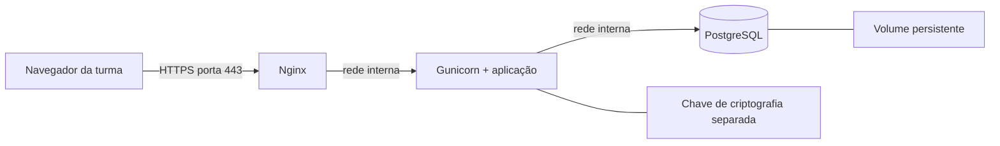

# Ubuntu 26.04.1 — rede local da aula

Configuração preparada para **https://10.81.211.237**. Não precisa de domínio. A VM precisa manter esse IP; confirme reserva DHCP ou configuração estática com o responsável pela rede.



Apenas a porta 443 do IP informado é publicada. PostgreSQL e Gunicorn não publicam portas na VM. Os campos pessoais continuam criptografados; a mudança de banco não transforma as compras em pagamentos reais.

## 1. Preparar a VM

Planeje 2 vCPUs, 2 GB de RAM e espaço para imagens e backups. Este é um ponto de partida para a aula, não um dimensionamento de carga.

Instale Docker Engine e o plugin Compose pelo [guia oficial para Ubuntu](https://docs.docker.com/engine/install/ubuntu/), que inclui Ubuntu 26.04. Instale também `python3` e `openssl`:

```bash
sudo apt update
sudo apt install -y python3 openssl
sudo systemctl enable --now docker
sudo docker compose version
```

Os comandos Docker abaixo usam `sudo`; não é necessário adicionar seu usuário ao grupo docker.

## 2. Copiar o projeto

Copie o código do projeto para uma pasta na VM, por exemplo `~/campus-market`, usando SCP/SFTP. Inclua os arquivos ocultos de configuração necessários, como `.dockerignore`. Não copie `.venv`, `__pycache__`, `.pg-test` ou pastas `test-data-*`.

Para **manter os usuários existentes**, pare o servidor Windows e o gerador antes de copiar:

- `data/market.db` — banco SQLite atual, já atualizado pela versão atual do código.
- `.secrets/market.key` — **a mesma chave usada para criptografar esse banco**.

Copie por SSH/SFTP, não envie a chave para a turma. Preserve um backup desses dois arquivos no computador original. Se MARKET_KEY_FILE apontava para outro local, copie a chave desse local para `.secrets/market.key` na VM. Se começar sem dados anteriores, não é preciso copiar banco nem chave.

## 3. Gerar configuração e certificado

Dentro da pasta do projeto, na VM:

```bash
sudo python3 deploy/prepare.py --ip 10.81.211.237
sudo docker compose config --quiet
sudo docker compose build
sudo docker compose up -d --wait db
```

O preparador cria `.env`, senhas aleatórias do banco, a chave de criptografia se não existir e um certificado TLS para o IP, válido por 30 dias. Preserva arquivos existentes e não substitui a chave de um banco importado. O arquivo `.env` deve conter:

```dotenv
MARKET_ORIGIN=https://10.81.211.237
BIND_IP=10.81.211.237
```

O diretório `.secrets` fica acessível somente ao root no host. Os arquivos montados nos containers têm permissões adequadas para cada serviço; a aplicação executa como UID 10001. As senhas não ficam no Dockerfile nem no Git. Os secrets do Compose são arquivos locais montados, não um cofre externo.

## 4. Importar o SQLite (se houver dados anteriores)

Execute **antes de iniciar a aplicação**:

```bash
sudo docker compose run --rm --no-deps --user 0 \
  -v "$PWD/data:/import:ro" app \
  python migrate_database.py --sqlite /import/market.db
```

O processo lê a origem sem alterá-la, verifica a chave e os registros criptografados, importa contas/perfis/anúncios/pedidos/eventos e ajusta as sequências de IDs. Exibe apenas contagens. Usa uma transação e recusa um destino já populado. Sessões e checkouts temporários não são copiados; todos precisam entrar novamente.

O comando usa root apenas para ler a cópia local durante a importação; a conexão ao PostgreSQL continua sendo a do usuário restrito `campus_app`. A aplicação normal não executa como root.

Se algo falhar, não apague banco nem chave: confira se o destino está vazio, se o SQLite foi atualizado e se a chave é a original. Uma nova implantação sem dados antigos pode pular esta etapa.

## 5. Iniciar a loja

```bash
sudo docker compose up -d
sudo docker compose ps
```

Abra **https://10.81.211.237**. O certificado é autoassinado: configure sua confiança nos computadores da aula após conferir a impressão digital SHA-256 por um canal confiável com o professor. Distribua apenas `deploy/tls/fullchain.pem`. Nunca distribua `privkey.pem` nem `market.key`.

Para verificar o servidor na própria VM sem desativar TLS:

```bash
sudo curl --cacert deploy/tls/fullchain.pem https://10.81.211.237/style.css
```

Se mudar o IP, atualize `.env` e forneça um novo certificado com o IP correto. O preparador preserva o certificado existente; não o renova silenciosamente. Para renovar, forneça o novo par `fullchain.pem`/`privkey.pem`, confira permissões e execute `sudo docker compose restart web`.

O bind limita a publicação à interface desse IP, mas não decide quais redes conseguem roteá-lo. Confirme a restrição à rede da aula no roteador/firewall. Portas publicadas pelo Docker podem contornar regras UFW; use regras compatíveis com o Docker, sem bloquear seu SSH por engano. Veja as [limitações oficiais de firewall](https://docs.docker.com/engine/install/ubuntu/#firewall-limitations).

## 6. Consultar o banco

```bash
sudo docker compose exec db psql -U postgres -d campus
```

No psql:

```sql
\dt
SELECT COUNT(*) FROM users;
SELECT COUNT(*) FROM profiles;
SELECT id, title, stock FROM listings ORDER BY id;
SELECT id, quantity, total_cents, status FROM purchases ORDER BY id;
\q
```

`users.name`, `profiles.data` e `purchases.delivery` aparecem criptografados. Isso é esperado. A aplicação não usa o superusuário: usa `campus_app`, sem privilégios de criar bancos, criar roles ou administrar o servidor. Ele pode criar e alterar suas próprias tabelas para executar as migrações; numa operação maior, separe também as credenciais de migração.

## 7. Gerador de usuários a cada minuto

No Windows, com o certificado público copiado para `certificado-vm.pem`:

```powershell
.\.venv\Scripts\python.exe generate_users.py --url https://10.81.211.237 --ca certificado-vm.pem
```

O gerador continua usando a rota normal de cadastro, sem acesso direto ao PostgreSQL. Ctrl+C encerra; `--count 10` limita a dez contas. Não é iniciado automaticamente no servidor.

## 8. Backup e restauração

Para criar um dump consistente:

```bash
sudo sh deploy/backup.sh
```

O arquivo fica em `backups/`. Guarde-o fora da VM. Faça também backup **separado** da `.secrets/market.key`; o dump sozinho não permite ler os dados criptografados. As senhas do banco também devem ser guardadas para recuperar a configuração.

Restaure em uma **implantação nova**, com PostgreSQL inicializado mas a aplicação ainda parada, usando a chave original antes de iniciar o app:

```bash
sudo docker compose up -d --wait db
sudo docker compose exec -T db pg_restore -U postgres -d campus \
  --exit-on-error --single-transaction < backups/SEU-BACKUP.dump
sudo docker compose up -d
```

O restore não usa `--clean`: falha se houver tabelas conflitantes, evitando apagar uma base em uso. Teste a restauração e o login antes de depender do backup. `docker compose down` preserva o volume; **não use `down -v`**, pois remove o banco persistente.

## Operação e limites

```bash
sudo docker compose logs --tail=100 app db web
sudo docker compose restart app
sudo docker compose exec app python app.py --events
```

Nginx termina HTTPS, limita requisições e sobrescreve os cabeçalhos de proxy. A aplicação confia somente no IP fixo do Nginx para identificar clientes. Gunicorn roda com um processo e oito threads: mantenha um processo enquanto os limites da aplicação forem em memória. Para escalar, mova os limites para armazenamento compartilhado. A integração do proxy segue a [documentação do Gunicorn](https://gunicorn.org/deploy/).

Não use `python app.py --host 0.0.0.0` como servidor da VM. O `http.server` continua disponível apenas como modo de desenvolvimento; a implantação usa a entrada WSGI no Gunicorn.

As imagens PostgreSQL 17 e Nginx stable recebem atualizações de patch pelas tags; atualize e valide deliberadamente (`docker compose pull` e rebuild) após backup. A configuração usa uma rede Docker `172.30.44.0/24`; se ela conflitar com uma rede existente, ajuste Compose, IP de proxy e Gunicorn juntos.

Esta é uma implantação persistente de laboratório, não uma certificação de produção para dados ou pagamentos reais. Continua sem MFA, recuperação/verificação de e-mail, pagamento real, transportadora e limitação distribuída. Não há auditoria independente nem teste de carga. Use dados sintéticos e mantenha o escopo local da aula.
